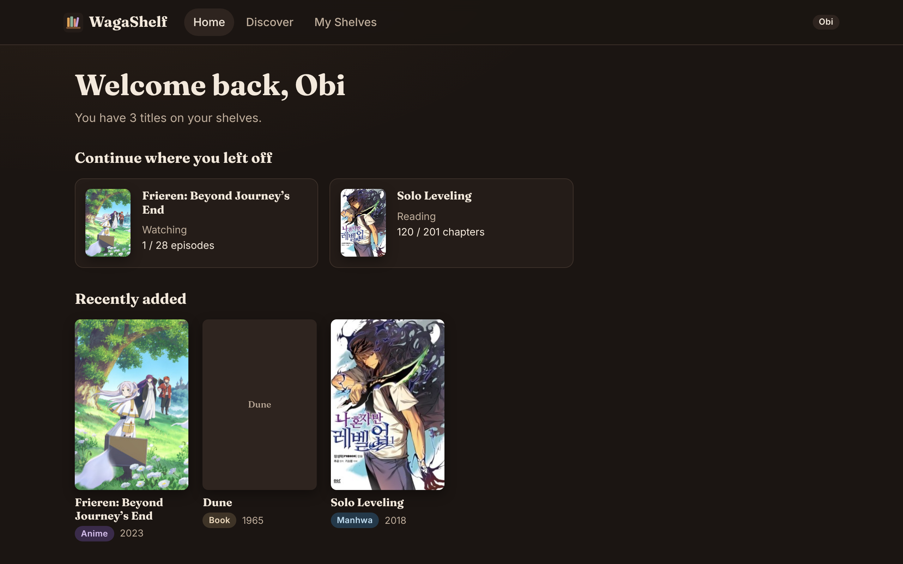
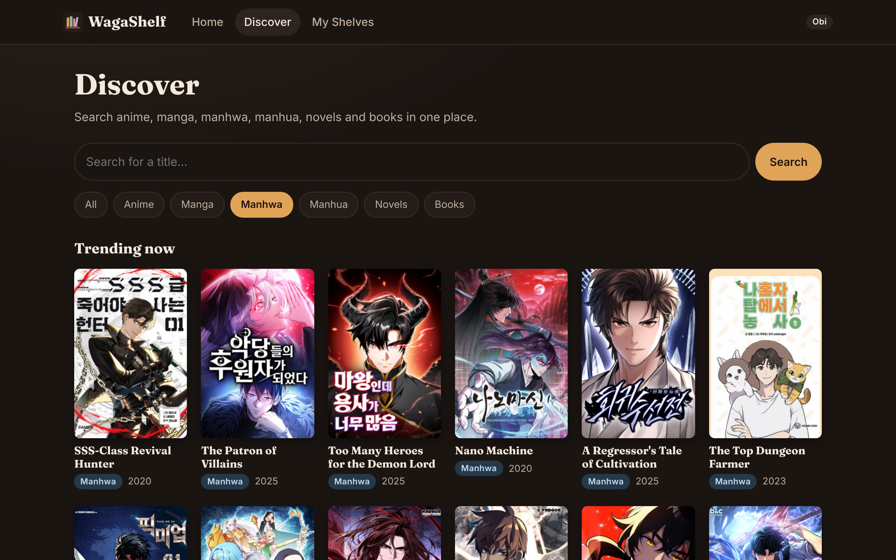
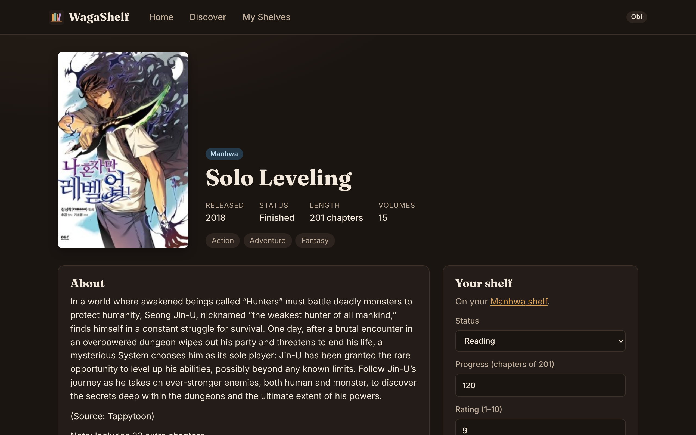
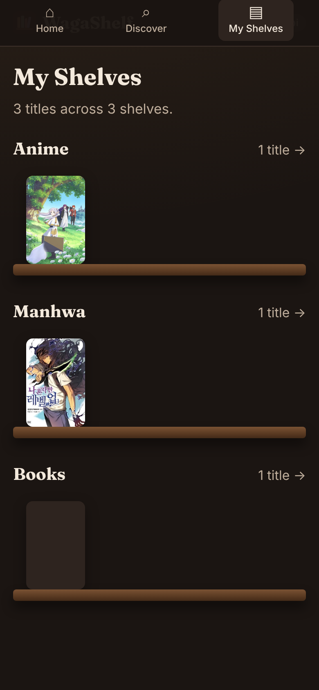
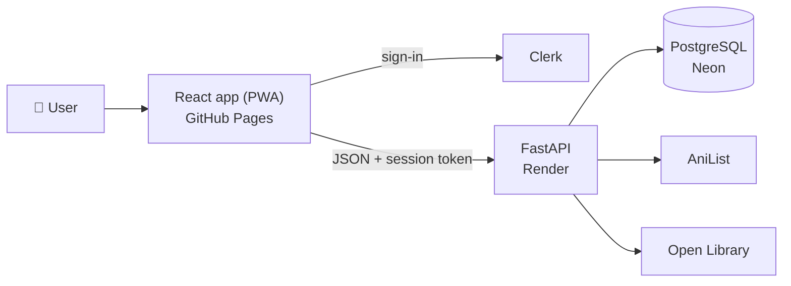

# WagaShelf

*Waga* (我が) means "my" in Japanese. **WagaShelf** is one cozy shelf for everything you watch
and read: anime, manga, manhwa, manhua, novels and books, all in one library.

People watch and read across many platforms, so their lists end up scattered or forgotten.
WagaShelf gives them one place to save titles, optionally track progress, keep private notes,
and find where to watch or read officially.

**Live app:** https://obich1.github.io/WagaShelf/



| Discover | Title page | On a phone |
|---|---|---|
|  |  |  |

## Features

- **Universal search** across AniList and Open Library, with media-category filters, plus
  trending titles to browse
- **Title pages** with description, genres, release info and **official links** (e.g.
  Crunchyroll, KakaoPage, Tapas)
- **Saving comes first:** add a title in one click; status and progress are optional
- **Shelves that build themselves:** one per media type you've saved, filterable by status, with
  quick status changes and +1 progress
- **Media-aware tracking:** episodes for anime, chapters for manga and novels, pages for books;
  "Watching" vs "Reading" wording
- **Ratings and private notes**
- **Home dashboard:** continue where you left off, recently added, shelf overview
- **Accounts** with Clerk; private by default
- **Installable** on phones and desktops (PWA), with a mobile layout

## Tech stack

| Part | Technology |
|---|---|
| Frontend | React, Vite, React Router, Clerk; hosted on GitHub Pages; installable PWA |
| Backend | Python, FastAPI, SQLModel (Pydantic + SQLAlchemy), PyJWT; hosted on Render |
| Database | PostgreSQL (Neon) in production, SQLite locally and in tests |
| Data sources | AniList GraphQL API, Open Library API |
| Quality | pytest test suite, GitHub Actions CI on every push and pull request |

## Architecture



The data model separates **shared catalogue information** (one `titles` row per title, used by
everyone) from each **user's personal entry** (status, progress, rating and private notes).
See [docs/architecture.md](docs/architecture.md) for the C4 diagrams, data model, API and the
reasoning behind each design decision.

## Running it

See [docs/deployment.md](docs/deployment.md) for local setup and deployment. In short:

```bash
# backend (from backend/)
pip install -r requirements.txt && fastapi dev main.py
# frontend (from frontend/)
npm install && npm run dev
```

## Product planning

The product vision, principles, MVP scope and open decisions are in
[docs/product-planning.md](docs/product-planning.md).

## Roadmap

- [x] Universal search, title pages, shelves, tracking, accounts, PWA
- [ ] Public profiles and shelf visibility
- [ ] Movies and TV (TMDB), video games
- [ ] Reviews and comments
- [ ] Import from AniList
- [ ] Recommendations
