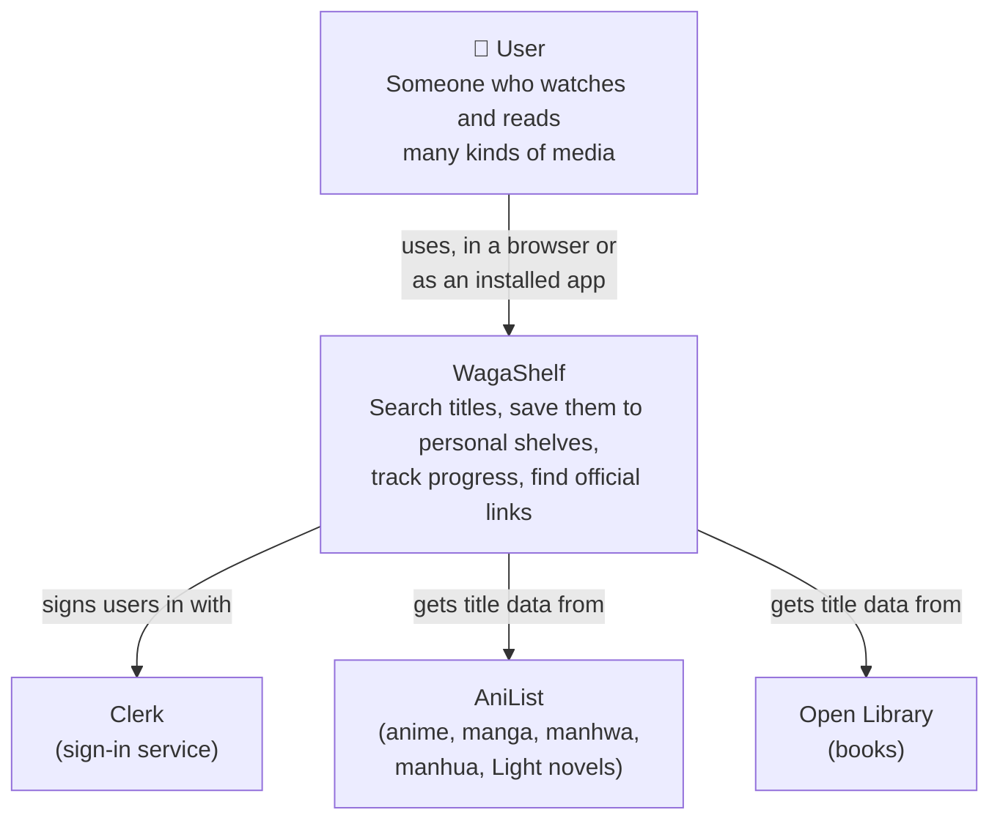
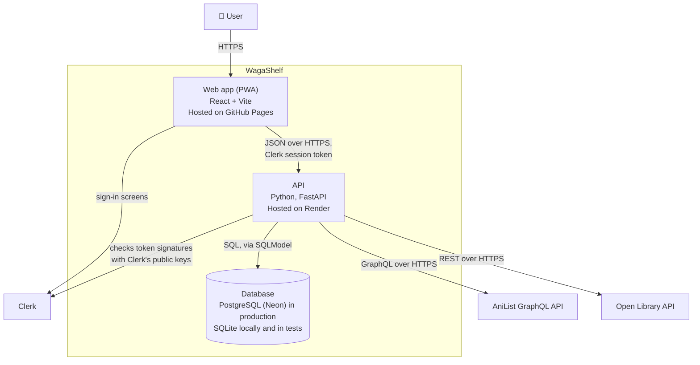
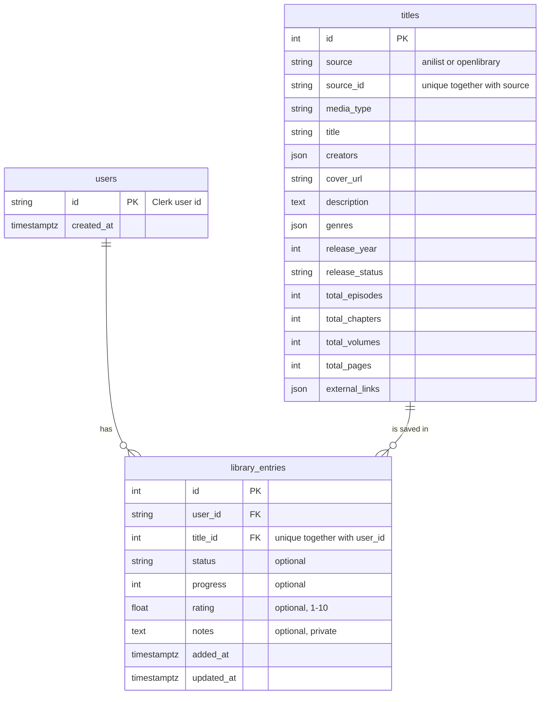

# WagaShelf architecture

This document describes how WagaShelf is built, using the [C4 model](https://c4model.com):
Level 1 (System Context) shows WagaShelf and what it talks to; Level 2 (Containers) shows the
separately running parts inside it. The last section lists the main design decisions and their
trade-offs.

## Level 1: System Context



## Level 2: Containers



### How a request flows: saving a title

1. On a title page, the user picks a status (optional) and clicks **Add to My Shelf**.
2. The React app asks Clerk for the user's current session token and sends
   `POST /library` with `{source, source_id, status}` and `Authorization: Bearer <token>`.
3. FastAPI checks the token (signature, expiry, issuer, website) and reads the user id from it.
4. Pydantic validates the body (allowed status values, rating 1–10, and so on). Invalid data is
   rejected with a `422`.
5. The catalogue service looks for the title in the shared `titles` table, fetching it from
   AniList or Open Library if WagaShelf doesn't have it yet.
6. A `library_entries` row links the user to the title. The database's unique rule on
   (user, title) makes duplicates impossible; the API answers `409` if it's already saved.
7. The API returns the entry with its title, and the React app adds it to the shared library
   state, so Home and the shelves update without reloading.

## Data model



## API

| Method | Path | Sign-in | Purpose |
|---|---|---|---|
| GET | `/health` | No | The server is running |
| GET | `/search?q=&category=` | No | Universal search; `category` is `all` or a media type |
| GET | `/trending?category=` | No | Popular titles, for Discover before searching |
| GET | `/titles/{source}/{source_id}` | No | Title details (refreshed and stored in the catalogue) |
| GET | `/library?media_type=&status=` | Yes | The user's saved titles, newest first |
| POST | `/library` | Yes | Save a title (`201`, or `409` if already saved) |
| PATCH | `/library/{id}` | Yes | Change status, progress, rating or notes |
| DELETE | `/library/{id}` | Yes | Remove from the shelf (`204`) |

Interactive documentation is generated by FastAPI at `/docs`.

## Frontend structure

```
src/
├─ main.jsx               HashRouter → AuthProvider (Clerk) → LibraryProvider → App
├─ App.jsx                Header, navigation and routes
├─ auth.jsx               The only file that uses Clerk directly
├─ config.js              API URL and Clerk publishable key (from VITE_ variables)
├─ api/client.js          fetch wrapper: adds the token, turns errors into readable messages
├─ library/LibraryContext.jsx   The user's library, loaded once and shared by all pages
├─ lib/media.js           Media types, status wording, progress labels
├─ components/            Cover, TitleCard, EntryEditor, loading/error/empty states
└─ pages/                 Home, Discover, TitleDetail, Shelves, Shelf
```

## Key decisions and trade-offs

| Decision | Why | Trade-off / alternative |
|---|---|---|
| **Shared catalogue + personal entries** (`titles` and `library_entries`) | Matches the product principle: facts about a title are shared, each user's relationship to it is private. No duplicated title data. | More joins than one flat table. |
| **Backend calls AniList and Open Library** | One common title format; the frontend doesn't know each source's API; sources can be added without frontend changes. | An extra network hop; more backend code. |
| **Partial results when a source is down** | One outage shouldn't break search. Stored titles are used if a source is down when viewing them. | Responses must say which source was unavailable. |
| **Clerk for sign-in** | Security-critical and not what makes WagaShelf different; includes sign-in UI, email verification and password reset. | Depends on an outside service; production needs a custom domain. Alternative: own password hashing and JWTs. |
| **Token verification with Clerk's public keys (JWKS)** | The API checks tokens itself, without calling Clerk on every request. | Keys are cached; a key rotation is picked up on the next unknown key id. |
| **SQLModel** | Tables and validation models in one style; works with SQLite and PostgreSQL. | A new library instead of raw SQL. |
| **PostgreSQL in production, SQLite in tests** | Hosted PostgreSQL keeps data safe across restarts; SQLite makes tests fast and isolated. | Small differences between the two (time zones, foreign keys) need care. |
| **Constraints in the database** (unique, foreign keys) | Rules hold even if application code has a bug. | Errors must be translated into friendly API responses. |
| **React + React Router with hash URLs** | Several pages; GitHub Pages only serves real files, so `#/` URLs avoid 404s on refresh. | URLs contain `#`. Alternative: a host with rewrite rules. |
| **One shared library state (React context)** | Every page sees the same data; changes appear everywhere immediately. | The whole library loads at sign-in (fine at personal-library sizes). |
| **PWA with a network-first service worker** | Installable on phones; always shows the newest version when online. | No full offline mode (deferred). |
| **GitHub Pages + Render + Neon** | Free tiers; each part deploys independently. | Render's free tier sleeps when idle, so the first request after a while is slow. |
